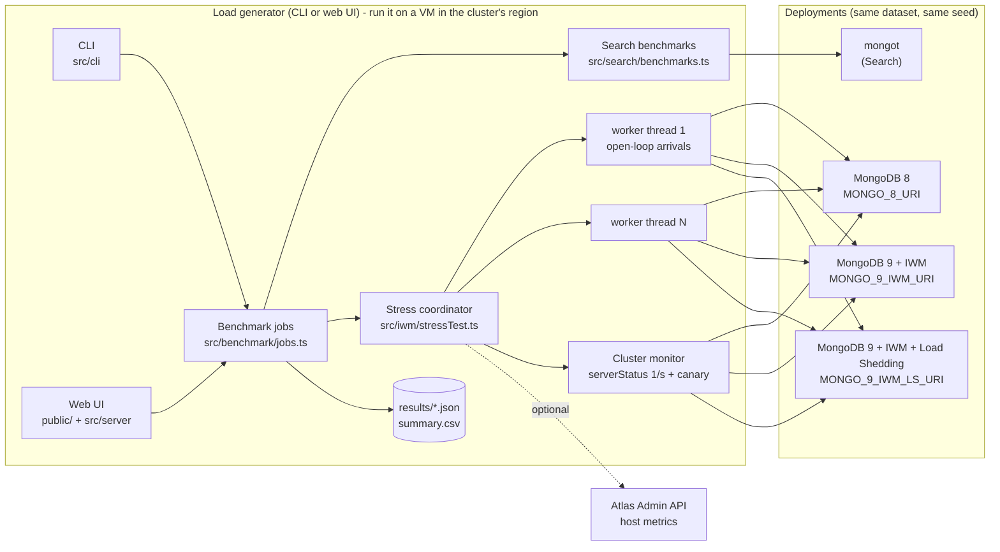

# Architecture

## Data flow of a stress test

1. **Schedule** (`src/iwm/schedule.ts`) - phases such as `baseline:30:1000, ramp:30:1000-8000,
   overload:60:8000, recovery:30:1000`. The cumulative arrival curve is the integral of this rate.
2. **Workers** (`src/iwm/worker.ts`) - each worker thread owns a `MongoClient` and issues its share
   of the arrival curve every 2 ms, without waiting for earlier requests (open loop). Latency is
   measured from the *scheduled* time; every request gets a `timeoutMS` deadline so stale
   requests never reach the server late.
3. **Operations** (`src/iwm/operations.ts`) - product page, category listing, search, checkout,
   inventory (critical) and analytics/heavy reports (non-critical, deliberately expensive).
4. **Per-second samples** go to the coordinator (merged across workers): counts by outcome and
   class, mergeable latency histograms, client event-loop lag, in-flight requests.
5. **Monitor** (`src/iwm/monitor.ts`) polls `serverStatus` every second (CPU, connections,
   execution queues, ingress limiter admitted/queued/rejected, server-side latency) and runs a
   low-rate canary read on its own connection pool.
6. **Summaries & interpretation** (`src/iwm/stressTest.ts`, `src/iwm/interpret.ts`) - per phase, per
   class, recovery time, validity checks (client-bound? overload reached?), and sentences generated
   from the numbers with a "similar" band instead of a hard-coded winner.

## Search benchmark design

`src/search/queries.ts` turns one `ShopperQuery` into: a ranked `$search`, a `$searchMeta` facet
query (counts, or counts + per-bucket aggregations), `$search → $group`, `$search (returnStoredSource)
→ $group`, and `$match → $group`. `src/benchmark/runner.ts` runs variants with a separate first run,
warm-up, shuffled interleaving and a throughput phase; results are compared with a bootstrap CI on
the median ratio, and only after a **parity check** proves the variants returned identical numbers.

## Adding the Queryable Encryption feature

- server: `src/server/routes/qe.ts` → mount in the `features` list in `src/server/index.ts`
- UI: replace `public/js/tabs/queryable-encryption.js` (already registered in `public/js/app.js`)
- data: a `customers` collection in the same `DB_NAME`; `orders.customerId` is 1..250,000
